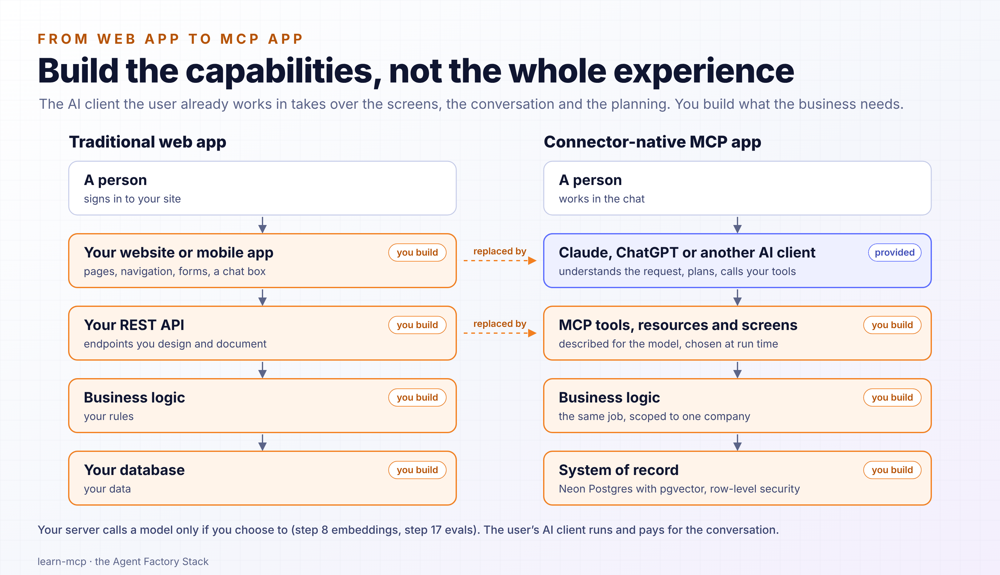
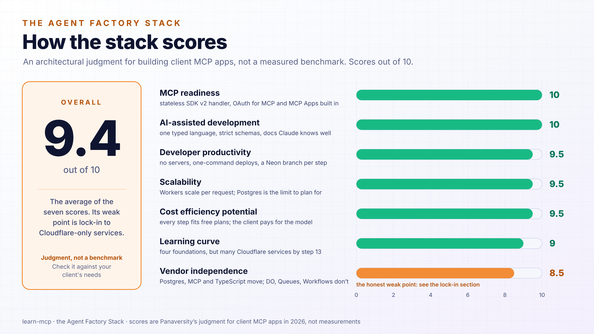

# The Agent Factory Stack: Why This Bootcamp Builds on TypeScript, Cloudflare, Better Auth, Neon and pgvector

Every step in this bootcamp uses the same small set of technologies. This guide explains why. It names the stack, shows how an MCP app differs from a traditional web app, maps each technology to the steps where you build with it, and is honest about the trade-offs.

**Read this as a recommended default, not an industry standard.** There is no single standard stack for MCP apps yet. This is the stack Panaversity recommends for its Forward Deployed Engineers and teaches in [The AI Agent Factory](https://agentfactory.panaversity.org/), because it lets one person build, secure and run a multi-tenant MCP app for a paying client on serverless infrastructure: cheap to start, scaling on its own, with no servers to manage. Once you understand why each piece is here, you will also know when a client's situation calls for something else.

## The architectural advantage: serverless-first

The biggest reason for this stack is architectural. **It is serverless-first, inexpensive to start, scales on its own, and asks you to manage no traditional server infrastructure.** For an FDE or a small startup, that means you spend your time on the client's business capabilities, not on running machines.

- **Serverless-first.** Your MCP server is a Cloudflare Worker: code that runs when a request arrives and stops when it is answered. Neon runs Postgres the same way. There is no machine sitting idle that you have to size, start or keep alive, and MCP's stateless 2026-07-28 spec fits this model, because any copy of your server can answer any call.
- **Inexpensive to start.** Cloudflare's free plan needs no credit card to sign up, every step of this bootcamp fits the free plans of Cloudflare and Neon, Neon scales to zero when nobody is using it, and the user's AI client pays for the model. You can build, demo and win a first client before you pay for hosting. Costs begin when traffic grows (Workers Paid, a paid Neon plan) or when your own server calls models heavily; the [Costs and cleanup](costs-and-cleanup.md) guide lists every service and its limits, and step 20 teaches you to price those costs in.
- **Scales on demand.** Workers start a fresh copy for each request, close to the user, so ten users and ten thousand use the same code and the same deploy. The part you still plan for is the database: connection limits, indexes and, for a big tenant, a dedicated Neon database (steps 6 and 7).
- **No servers to manage.** No virtual machines, operating systems to patch, load balancers, container clusters or database servers to run. `wrangler deploy` publishes your app, and Cloudflare and Neon run the infrastructure underneath it.

**What you still own.** Serverless removes the servers, not the responsibility. Your code, your schema, each company's isolation, your secrets, your security and your bill are still yours, and most of this bootcamp is about getting those right.

## The guiding idea

> **Build the business capabilities. Expose them through MCP. Let AI clients provide the intelligence. Keep business data in a reliable system of record.**

The rest of this guide follows from that sentence.

## The stack at a glance

We call it **the Agent Factory Stack**: four foundations and one protocol, with pgvector inside the database so that search by meaning lives with the rest of the data.

<picture>
  <source media="(prefers-color-scheme: dark)" srcset="../assets/diagram-agent-factory-stack-dark.png">
  <source media="(prefers-color-scheme: light)" srcset="../assets/diagram-agent-factory-stack-light.png">
  
</picture>

| Role | Choice | What it does for you |
| --- | --- | --- |
| Language | **TypeScript** | One typed language for the server, sign-in, database code, widgets and tests |
| Infrastructure | **Cloudflare** (Workers first) | Serverless compute, deployed with one command, with more services added only when a step needs them |
| Identity | **Better Auth** | Sign-in, OAuth for MCP clients, companies and roles, and single sign-on |
| System of record | **Neon Postgres** | Business data with transactions, constraints and row-level security |
| Search by meaning | **pgvector** (in the same Neon database) | Embeddings beside the rows they describe, under the same row-level security, so search by meaning cites or abstains without a second database |
| Integration protocol | **MCP** | How Claude, ChatGPT and other AI clients reach your app's tools, data and screens |

Everything else in the bootcamp is a library inside those, not another platform to run.

## From a traditional app to a connector-native app

A traditional web app builds every layer itself. An MCP app (a *connector-native* app) hands the conversation, the reasoning and much of the interface to the AI client the user already works in.

<picture>
  <source media="(prefers-color-scheme: dark)" srcset="../assets/diagram-mcp-app-shift-dark.png">
  <source media="(prefers-color-scheme: light)" srcset="../assets/diagram-mcp-app-shift-light.png">
  
</picture>

| Layer | Traditional web app | Connector-native MCP app |
| --- | --- | --- |
| Who starts the work | A person | A person |
| Where they work | Your website or mobile app | Claude, ChatGPT or another AI client |
| How the request reaches you | Your REST API | MCP tools, resources and MCP Apps screens |
| Business logic | Your server | Your server (the same job) |
| Data | Your database | Your system of record (Postgres with pgvector), with each company kept apart |

What changes is where your effort goes. You don't build navigation, forms for every case or a chat box. You build business capabilities, describe them well (step 2), protect them (steps 4, 6, 7 and 16) and give the model screens it can choose at run time (steps 9 and 19). The model understands the request, plans and calls your tools.

**Your app doesn't need its own model subscription.** The user's AI client runs the model and pays for it. Your server calls a model only when you choose to, as this bootcamp does for embeddings on Workers AI in step 8 and for the eval script in step 17. If you do, count that cost and build it into your price (book lesson [17.9 How do you charge for a connector?](https://agentfactory.panaversity.org/building-ai-workers/connectors-and-mcp/charging-for-a-connector/)).

## Why these foundations

**TypeScript: one language across the stack.** Your MCP server, Better Auth setup, SQL calls, React widgets and tests are all TypeScript, so you learn one language well and Claude writes and reviews code in one place. Strict types catch mistakes before you deploy, and tool input schemas (Zod, from step 2) become both validation and documentation for the model. *Steps: all.*

**Cloudflare: infrastructure you don't manage.** A Worker starts fresh for each request, runs close to the user and scales without servers to patch. That fits MCP's 2026-07-28 spec, which made the protocol stateless: any copy of your server can answer any call (book lesson [17.4 What if a different copy answers the next call?](https://agentfactory.panaversity.org/building-ai-workers/connectors-and-mcp/stateless-servers/)). Cloudflare's stateless [`createMcpHandler`](https://developers.cloudflare.com/agents/model-context-protocol/apis/handler-api/) serves an MCP SDK v2 server from a Worker. When the app grows, storage, background jobs and durable workflows are on the same platform, bound to the same Worker. *Steps: all.*

**Better Auth: identity and access in your own code.** Better Auth is an open-source TypeScript library, not a hosted service. It runs inside a Worker, keeps its records in your own D1 database, and its [MCP plugin](https://better-auth.com/docs/plugins/mcp) turns it into the OAuth server that Claude and ChatGPT sign in through. Its [1.7 release](https://better-auth.com/blog/1-7) added support for the MCP 2026-07-28 authorization profile and version 2 of the official MCP TypeScript SDK. Its [organization](https://better-auth.com/docs/plugins/organization) plugin gives you companies and roles, and its open-source [SSO](https://better-auth.com/docs/plugins/sso) plugin gives enterprise clients the single sign-on they expect. Book chapter [18](https://agentfactory.panaversity.org/building-ai-workers/securing-connectors/) teaches it in depth. *Steps: 4 on.*

**Neon Postgres: the system of record.** Business records need transactions, constraints, joins and a database that enforces who may see which rows. Postgres does all of that, and its pgvector add-on searches by meaning in the same tables under the same rules, so you don't need a separate vector database. Neon runs Postgres for you, scales to zero when idle and gives you a branch per step in seconds. Postgres is open source and runs on many hosts, so your schema, SQL and row-level security move with you if you ever leave Neon (book lesson [19.1 Why move the data out of the code?](https://agentfactory.panaversity.org/building-ai-workers/business-data-and-retrieval/why-a-database-now/)). *Steps: 5 on.*

**pgvector: search by meaning in the system of record.** Clients ask questions their data answers only by meaning: "what is our returns policy for damaged stock?" pgvector is a Postgres extension that stores embeddings (lists of numbers that capture what a passage means) in ordinary columns and finds the closest ones with SQL. Because the embeddings sit in the same Neon tables as the business rows, the same row-level security keeps each company's passages apart, one backup covers both, and a search can join straight to the record it cites. That is why the bootcamp uses pgvector instead of a separate vector database such as Cloudflare Vectorize, which would need its own copy of every company's data and its own isolation rules. In step 8 you embed passages with `bge-m3` on Workers AI, search them through a tenant-scoped tool that cites document and line or abstains below a threshold, and measure it with a retrieval question set in CI. Steps 19 and 21 build on it (book lessons [19.13 How does a search find a rule by its meaning?](https://agentfactory.panaversity.org/building-ai-workers/business-data-and-retrieval/retrieval-from-zero/) and [19.15 What if the policies do not answer the question?](https://agentfactory.panaversity.org/building-ai-workers/business-data-and-retrieval/answers-that-cite-or-abstain/)). *Steps: 8 on.*

## Why TypeScript and Workers, not Python and containers

An MCP app is mostly integration engineering: the AI client brings the intelligence, and your app brings signed-in access to business data, tools and screens. For that job the stack defaults to **TypeScript** (one language from the React widget to the database, with the type checker catching an agent's mistakes before the tests) and to **Workers** (stateless tool calls that mostly wait on a database, starting far faster than a container and billed for CPU time rather than waiting). Python stays the right choice for machine learning and data science, and containers for heavy or native workloads, which Cloudflare Containers can run beside a Worker when a client project needs them.

Read **[TypeScript and Workers by Default](why-typescript-and-workers.md)** for the full comparison, three diagrams, when to choose Python or a container, and the six engineering principles behind the stack. For the strongest alternative host, read **[Cloudflare Workers or Google Cloud Run?](workers-vs-cloud-run.md)**.

## Where each technology appears in this bootcamp

| Layer | Technology | Steps |
| --- | --- | --- |
| Language | TypeScript (strict), type-checked with TypeScript 7 | All |
| Compute and deploy | Cloudflare Workers, Wrangler | All |
| MCP server | `createMcpHandler` (`agents/mcp/server`) with MCP SDK v2, Streamable HTTP at `/mcp` | All |
| Input validation | Zod schemas for every tool | 2 on |
| Identity | Better Auth (MCP, organization and SSO plugins) with Cloudflare D1 | 4 on |
| System of record | Neon Postgres, numbered SQL migrations | 5 on |
| Database connectivity | Cloudflare Hyperdrive, forced row-level security | 6 on |
| Search by meaning | pgvector on Neon, `bge-m3` embeddings on Workers AI | 8 on |
| Interactive screens | MCP Apps widgets in React (`@modelcontextprotocol/ext-apps`) | 9 on |
| Tests | Vitest in the Workers runtime, plus evals | 1, 17 on |
| Payments | Stripe in test mode | 20 |

## Cloudflare services, one at a time

You don't learn every Cloudflare service on day one. Each arrives in the step that needs it, bound to the same Worker that serves `/mcp`, so you never change platforms as the app grows.

| Service | What it's for | First used |
| --- | --- | --- |
| [Workers](https://developers.cloudflare.com/workers/) | Every MCP server | Step 1 |
| [Workers KV](https://developers.cloudflare.com/kv/) | Small, read-mostly data: notes, per-company settings, caches | Step 2 |
| [D1](https://developers.cloudflare.com/d1/) | Sign-in data only | Step 4 |
| [Hyperdrive](https://developers.cloudflare.com/hyperdrive/) | Pooled, fast connections to Neon | Step 6 |
| [Workers AI](https://developers.cloudflare.com/workers-ai/) | Embeddings for search by meaning | Step 8 |
| [Durable Objects](https://developers.cloudflare.com/durable-objects/) | Small per-user or per-company state that must be consistent: drafts, rate limits | Step 11 |
| [Queues](https://developers.cloudflare.com/queues/) | Background and bulk work | Step 12 |
| [Workflows](https://developers.cloudflare.com/workflows/) | Durable, multi-step jobs, and the engine behind MCP Tasks | Steps 13 and 14 |

**Services this bootcamp leaves out, and why.** [R2](https://developers.cloudflare.com/r2/) stores files and attachments; step 12 notes how bulk imports would use it once clients support MCP file uploads. [Vectorize](https://developers.cloudflare.com/vectorize/) is a separate vector database; we keep embeddings in Postgres with pgvector instead, under the same row-level security as the rest of the data. [AI Gateway](https://developers.cloudflare.com/ai-gateway/) monitors and controls calls to models; it matters when your server calls models heavily, which this bootcamp's servers don't. The wider [Agents SDK](https://developers.cloudflare.com/agents/) builds autonomous agents; we use only its MCP handler here, and AI Workers belong to Part II. Each is a reasonable addition to a client project later, and the step 21 capstone lets you add an extra if you justify it.

## Two decisions this stack makes for you

**1. One authorization server: Better Auth.** Cloudflare also offers its own [Workers OAuth Provider](https://github.com/cloudflare/workers-oauth-provider) library, which supports the MCP 2026-07-28 authorization spec and runs an authorization server inside a Worker. Either can sign in Claude and ChatGPT. We choose Better Auth because an MCP app for business clients also needs users, companies, roles and single sign-on, and Better Auth provides all of them. Running both would mean operating two authorization servers for no gain, so pick one. Book chapter 18's field guide compares them ([F10 How today's tools realize it, in detail](https://agentfactory.panaversity.org/building-ai-workers/securing-connectors/field-guide-securing-connectors/#f10-how-todays-tools-realize-it-in-detail)).

**2. One database, the right connection.** Neon is the system of record from step 5, and there are two ways to reach it from a Worker. **Hyperdrive** with a standard Postgres driver such as `pg` (node-postgres) keeps a pool of connections close to the database; both [Cloudflare](https://developers.cloudflare.com/hyperdrive/examples/connect-to-postgres/postgres-database-providers/neon/) and [Neon](https://neon.com/docs/guides/cloudflare-workers) recommend it, and this bootcamp uses it from step 6, with query caching turned off so one company's cached answer never reaches another. Neon's [serverless driver](https://neon.com/docs/serverless/serverless-driver) connects directly over HTTP or WebSockets with no Hyperdrive; it is a fine choice for a small project. Use one or the other, never the serverless driver through Hyperdrive.

## Libraries we deliberately don't add

You will see other stacks that pair these four with more libraries. Two common ones are left out of the bootcamp on purpose:

- **An ORM such as Drizzle.** You write SQL and numbered migrations yourself, because book chapter 19 teaches you to read SQL that an agent wrote, and row-level security policies are SQL. An ORM is a reasonable choice in a client project once you can read the SQL it produces.
- **A web framework such as Hono.** `createMcpHandler` and Better Auth's own handler already route the requests an MCP server needs, so a framework would add a layer to learn without adding a capability.

## How the stack scores

How good is this stack for building MCP apps for clients? Here is our scorecard. **These scores are an architectural judgment, not a measured benchmark.** They record how well the stack fits the work this bootcamp prepares you for (multi-tenant MCP apps for paying clients, built by a small team with Claude) as of November 2026. A different job would score it differently, so use the reasons, not the numbers, when you advise a client.

<picture>
  <source media="(prefers-color-scheme: dark)" srcset="../assets/diagram-agent-factory-stack-scores-dark.png">
  <source media="(prefers-color-scheme: light)" srcset="../assets/diagram-agent-factory-stack-scores-light.png">
  
</picture>

| Criterion | Score | Why | What would lower it |
| --- | --- | --- | --- |
| MCP readiness | 10 | Cloudflare's stateless `createMcpHandler` serves an MCP SDK v2 server, Better Auth's MCP plugin supports the 2026-07-28 authorization profile, and MCP Apps widgets are standard. Nothing has to be built around the stack to speak MCP | A client that needs an MCP feature these libraries don't support yet |
| AI-assisted development | 10 | One typed language end to end, tight Zod schemas and well-documented, widely used libraries, so Claude writes and reviews the code with few surprises | Libraries newer than the model's knowledge, which is why every step links the official docs |
| Developer productivity | 9.5 | No servers to run, one-command deploys, local development with Wrangler, and a Neon branch per step | Configuring several bindings and secrets per environment, which takes care (step 18) |
| Scalability | 9.5 | Workers start fresh per request and scale without planning; Hyperdrive pools connections to Neon | Postgres is the part that needs planning at high load: connection limits, indexes and, for big tenants, a dedicated database (step 7) |
| Cost efficiency potential | 9.5 | Every step fits the free plans, Neon scales to zero, and the user's AI client pays for the model | Heavy model use on your own server (embeddings, evals) and Workers Paid once traffic grows. Count both and price them in (step 20) |
| Learning curve | 9 | Four foundations and one protocol, introduced one at a time | By step 13 you know KV, D1, Hyperdrive, Workers AI, Durable Objects, Queues and Workflows, each with its own rules |
| Vendor independence | 8.5 | TypeScript, MCP, Postgres with pgvector, SQL and Better Auth all move to another host | Durable Objects, Queues, Workflows, KV, D1 and Hyperdrive run only on Cloudflare. This is the stack's real weakness, covered in the next section |

**Overall: 9.4 out of 10**, the average of the seven scores. Two of them deserve a caution. The 10s say the stack is as ready as anything available today, not that it is perfect. And the lowest score is the one most likely to matter to a large client, so read the next section before you promise a client that their app can move.

Before you adopt the stack for a client, test the full sign-in flow in every client they will use (Claude and ChatGPT at least), because authorization is where clients still differ most. Steps 4 and 18 have you do exactly that.

## The honest trade-off: lock-in

The weak point of this stack, and its lowest score, is that some of it only runs on Cloudflare. Know which parts move with you and which don't:

| Moves with you | Tied to Cloudflare |
| --- | --- |
| TypeScript, your tool schemas and business logic | Workers runtime bindings |
| MCP and MCP Apps (open standards) | Workers KV, D1 and Hyperdrive |
| Postgres, your SQL, row-level security and pgvector | Durable Objects, Queues and Workflows |
| Better Auth (runs on Node.js and other runtimes) | Workers AI |

Two habits keep the cost of a move low. Keep business logic in plain TypeScript modules that take their inputs as arguments, with the Cloudflare bindings at the edges. And keep business data in Postgres, where any host can run it. Figure 19.2 in the [chapter 19 overview](https://agentfactory.panaversity.org/building-ai-workers/business-data-and-retrieval/overview/) puts it simply: the rules are portable, and the host is a choice.

## When to choose something else

This is a default, so a client can have good reasons to depart from it: an existing identity provider they must keep (use it, and keep the MCP side standard), data that must stay in a particular cloud or country, a team that works in Python, or heavy model use that calls for a gateway. Write the reason down, the way the step 21 capstone asks you to justify each extra.

---

Back to the [main README](../README.md#tech-stack) · [Costs and cleanup](costs-and-cleanup.md) · [CCDV-F skills map](ccdv-f-skills-map.md)
