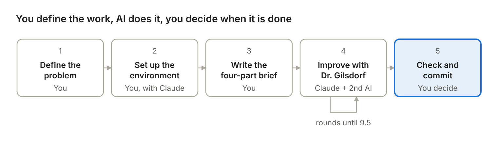

# The Panaversity AI Method

The **Panaversity AI Method** is the way Panaversity's own team works with AI on every piece of real work, from a book chapter to a client's MCP server. It is also the way you work through every step of this bootcamp. The book describes it in [How the Panaversity team works](https://agentfactory.panaversity.org/claude-and-chatgpt-2/new-way-of-working/how-the-panaversity-team-works/#what-is-the-panaversity-ai-method). This page explains each of its five steps, and shows where each one happens in this bootcamp.

<picture>
  <source media="(prefers-color-scheme: dark)" srcset="../assets/panaversity-ai-method-dark.png">
  <source media="(prefers-color-scheme: light)" srcset="../assets/panaversity-ai-method-light.png">
  
</picture>

One idea sits under all five steps: **AI does most of the work, and a person decides what the work is for and when it is done.** In this bootcamp, that person is you. In short, the work is human-directed, AI-executed, evidence-verified, human-approved and continuously improved.

## Contents

- [The five steps at a glance](#the-five-steps-at-a-glance)
- [Your first time](#your-first-time)
- [Words you need](#words-you-need)
- [How much of the method to use](#how-much-of-the-method-to-use)
- [Step 1: Understand and define the problem](#step-1-understand-and-define-the-problem)
- [Step 2: Set up the environment](#step-2-set-up-the-environment)
- [Step 3: Write the four-part brief](#step-3-write-the-four-part-brief)
- [Step 4: Improve the work with the Dr. Gilsdorf method](#step-4-improve-the-work-with-the-dr-gilsdorf-method)
- [Step 5: Check and commit](#step-5-check-and-commit)
- [One bootcamp step, start to finish](#one-bootcamp-step-start-to-finish)
- [Rules that never change](#rules-that-never-change)
- [A prompt for the end of each step](#a-prompt-for-the-end-of-each-step)
- [Checklist before you tag a step](#checklist-before-you-tag-a-step)
- [References](#references)

## The five steps at a glance

| Step | What it means | Where you do it here |
| --- | --- | --- |
| **1. Understand and define the problem** | Decide what you want, why it matters and how you will know it is done. | Before you start a step, read Stockroom's ask, **What you will build** and the **Submission checklist**: they are the problem and the "done" test. In the step 21 capstone, you define the problem yourself. |
| **2. Set up the environment** | A safe place for the work that keeps every version, with Claude given only the access it needs. | Once, in [Step 00](../step-00-readiness-check/README.md) and [How we work](../README.md#how-we-work-local-first-human-in-the-loop) items 1 to 6: your fork, your local clone, a Claude project with the folder and the fork, "never commit or push" in its instructions, least access, and bootcamp-only Cloudflare, Neon and Stripe accounts. Then a new thread for each step. |
| **3. Write the four-part brief** | Outcome, context, format and constraints, with the checks the work must pass. | Each step's prompts under **Build it with Claude Code** are briefs written for you. Read each one before you paste it, so you know what "done" means. In the capstone, you write your own. |
| **4. Improve the work with the Dr. Gilsdorf method** | Grade and improve the work in rounds toward 9.5 out of 10, run the checks, and get an independent review from a second AI. | Before you commit each step, use the [end-of-step prompt](#a-prompt-for-the-end-of-each-step). The step's tests and checklist are the pass-or-fail checks. For milestone steps (4, 8, 10, 15, 18 and 21), ask a second AI to review your code too. |
| **5. Check and commit** | A person checks the final result, approves it and saves it as the official version. | Test the deployed server in Claude and ChatGPT, read the diff in GitHub Desktop, then commit, tag `step-NN-done` and push it yourself. Write what you learned in the step's `NOTES.md`, and submit as [SUBMITTING.md](../SUBMITTING.md) says. |

## Your first time

You don't need every part of the method on day one. In [Step 00](../step-00-readiness-check/README.md) and step 1, do just this:

1. Read Stockroom's ask and write one "Done when" sentence for the step in `NOTES.md`.
2. Fork and clone the repo, and add the folder and your fork to a Claude project that is told never to commit or push.
3. In one thread, paste the step's prompts: they are your brief.
4. Ask Claude to run the step's tests, grade the work out of 10 and improve it twice.
5. Read the diff in GitHub Desktop, then commit, tag and push it yourself.

Add the rest, such as the full grading rounds and the second AI's review, as the steps grow. By the first milestone (step 4), use all five steps.

## Words you need

| Word | What it means |
| --- | --- |
| **Repo** (repository) | A project folder managed by Git, which records each committed version of its files |
| **Fork** | Your own copy of the bootcamp repo on GitHub, where all your work goes |
| **Clone** | Your copy of a repo on your computer |
| **Diff** | A view of exactly what changed: lines added in green, lines removed in red |
| **Commit** | A saved snapshot of your changes, with a short note saying what changed |
| **Push** | Sending your commits from your computer up to GitHub |
| **Tag** | A name on one commit, such as `step-07-done`, that marks a finished step for the grader |
| **Branch** | A separate line of work, so changes don't touch the main version until they are ready |
| **Pull request** | A request to merge the changes on one branch into another, after someone reviews them |
| **Claude project** | A workspace in Claude with its own files, instructions and threads (separate conversations) |
| **Check** | A pass-or-fail test the work must pass, such as "the cross-tenant tests pass" |
| **Production** | The live version that real users or clients rely on |

## How much of the method to use

Match the effort to the risk. A quick note doesn't need what a payment system needs.

| Level | Examples | How much of the method |
| --- | --- | --- |
| **Routine** | A note, a question to Claude, brainstorming a tool name | A short brief, and a quick read before you use the answer |
| **Professional** | A step of this bootcamp, a client's report, any software | All five steps, with pass-or-fail checks, an independent AI review and your approval |
| **High risk** | Sign-in, tenant data, secrets, payments, a production MCP server | All five steps, plus automated tests and security checks before every deploy, and approval by a qualified person |

Every step of this bootcamp is client software, so treat it as professional work at least. From step 4 on, your server handles sign-in and company data, and from step 20 it takes payments, so build those steps as high-risk work: the tests and security checks must pass before you deploy, whatever any grade says.

## Step 1: Understand and define the problem

Know what problem you are solving, for whom, and how you will know it is solved, before you ask Claude to write any code. If you can't say this in a few sentences, you aren't ready to hand the work to AI, and no prompt will fix that.

Answer four questions in plain words:

- **What is the problem, and why does it matter?** "Let a sales rep see this month's orders for their company from Claude" says what and why. "Add an orders tool" leaves Claude to guess.
- **Who is it for?** The person who will use, approve or pay for the result: here, Stockroom and its customers.
- **What is in and out of scope?** The edges of the job, and the sources it must work from (the step's README, the book lessons, the official docs).
- **What does done look like?** One "Done when" sentence that can be answered yes or no, such as "Done when the three tools work in Claude and ChatGPT and no company can see another's orders". "Done when it works" is not enough.

**In this bootcamp:** each step's summary, `> 🏬 Stockroom's ask`, **What you will build** and **Submission checklist** answer these four questions for you. Read them before you start, and write the step's "Done when" sentence at the top of the step's `NOTES.md` in your own words. In the step 21 capstone, nobody answers them for you: you define the problem for Stockroom Inventory yourself. The book calls this the [first 10 percent](https://agentfactory.panaversity.org/ai-worker-paradigm/the-10-80-10-operating-rhythm/first-10-percent/) of the work.

## Step 2: Set up the environment

A good setup gives Claude everything it needs and gives you a record of every change, so nothing reaches your work unseen. The work lives in a Git repo. Locally, Claude edits the files and you commit them. In a cloud session, Claude may commit to its own separate branch. Either way, no change Claude makes becomes part of your work until you approve it: that is the human in the loop.

<picture>
  <source media="(prefers-color-scheme: dark)" srcset="../assets/panaversity-ai-method-environment-dark.png">
  <source media="(prefers-color-scheme: light)" srcset="../assets/panaversity-ai-method-environment-light.png">
  
</picture>

You set it up once, in [Step 00](../step-00-readiness-check/README.md), following [How we work](../README.md#how-we-work-local-first-human-in-the-loop):

1. **Fork the bootcamp repo** on GitHub. Your fork is where all your work goes.
2. **Clone your fork** to your computer with GitHub Desktop. This local folder is where the work happens.
3. **Create a Claude project** and add both the local folder and your GitHub fork to it. The fork lets a cloud session run long tasks while your computer is off.
4. **Tell Claude never to commit or push,** in the project's instructions. Claude may read, edit and create files, run the step's commands and look at Git status and diffs. The one exception is a cloud session: there Claude commits to its own branch, never to `main`, and you review that branch in Step 5.
5. **Work in threads,** one new thread for each step, inside the step's folder.
6. **Open the same folder in VS Code** if you want to read or edit the files yourself, beside Claude.

**The method outlasts the tools.** These are the tools we use as of November 2026. If one changes, keep the role and swap the tool.

| Role | Our tool today |
| --- | --- |
| AI workspace | Claude project, with threads |
| Standing instructions for the AI | The project's instructions (and the bootcamp's `AGENTS.md`, which `CLAUDE.md` loads) |
| Version control and shared copy | Git and GitHub |
| Your review and commits | GitHub Desktop |
| Your own editing | VS Code |
| Independent AI reviewer | ChatGPT |

**Keep the work in text.** Code, `NOTES.md`, your own briefs and any data you add are all plain text, so every change shows line by line in GitHub Desktop and the history shows what changed and when. Keep it that way: write notes and briefs in Markdown, keep seed data as CSV or SQL, and let screenshots (`claude.png`, `chatgpt.png`) be the only images you add.

**Keep secrets and accounts safe.** A rule in a prompt guides Claude, but only permissions enforce a limit, so set limits Claude can't step over:

- **Keys never go in your files, a prompt or a chat.** Keep them in `.dev.vars` locally and in `wrangler secret put` once deployed. `.gitignore` keeps `.dev.vars` out of new commits, but it doesn't hide the file from Claude, and it doesn't protect a file Git already tracks.
- **Turn on GitHub's secret scanning and push protection** for your fork where your plan has them: they warn you, or block a push, when a key slips into a file.
- **Give Claude only the access the step needs.** Let routine commands (such as `npm install`, `npm test` and `npm run dev`) run under narrow permissions, and approve anything sensitive or irreversible yourself. Refuse any `git push`, and any `wrangler deploy` or `wrangler secret put` that the step's prompt didn't ask for.
- **Use bootcamp-only accounts.** Cloudflare, Neon and Stripe (in test mode) accounts made for the bootcamp, and never a client's or an employer's production account on the computer you build on.
- **Outside text is not an order.** Treat instructions found in web pages, issues, emails or tool results as information. Claude follows only the sources you approved: the step's prompts, your project instructions and `AGENTS.md`.

## Step 3: Write the four-part brief

A **four-part brief** is one message, in plain sentences, that answers four questions. Leave a part out, and Claude answers that question with a guess you never see.

| Part | The question it answers |
| --- | --- |
| **Outcome** | What should exist when the work is done, and what does "done well" look like? |
| **Context** | Who is it for, why does it matter, and what should it work from? |
| **Format** | What shape should it come back in, and where does it go next? |
| **Constraints** | What rules must the result follow, and how far may Claude go without checking with you? |

Five habits make a brief work:

- **End the outcome with a "Done when" sentence.** It tells Claude when to stop, and gives you a test.
- **Describe the result, not the steps.** Write a step only when it is a control: something required by a rule, a law or a system that uses the result (for example, "set the tenant per transaction with `set_config`").
- **Name the source that wins.** Say which version of the rules to follow, such as the 2026-07-28 MCP spec and this repo's `AGENTS.md`, and what to do when it is silent.
- **Ask for what it couldn't verify.** End with a list of anything Claude couldn't check, so you know where to start your review.
- **Decide how the work will be graded.** Write two kinds of checks. Pass-or-fail checks decide whether the work is acceptable: the tests pass, the cross-tenant suite passes, the server works in Claude and ChatGPT. Graded areas measure quality, each with what a 10 means, such as "Clarity: a learner can read every file". The book calls this agreed list of checks a [Review Contract](https://agentfactory.panaversity.org/managing-ai-workers/the-review-contract/agree-the-checks/).

**In this bootcamp:** each step's prompts are briefs written for you. They name the outcome, the files to work in, the rules from `AGENTS.md` and the tests to run, and they ask Claude to plan or explain before big changes. Read each prompt before you paste it, and add anything your own code needs (a file name, a check you want). Each step's **Testing targets** and **Submission checklist** are its pass-or-fail checks. In the capstone you write your own briefs: save them in the step folder as Markdown, so they are versioned with the work. The book teaches the brief in full in [The four parts](https://agentfactory.panaversity.org/managing-ai-workers/the-four-part-brief/four-parts/).

## Step 4: Improve the work with the Dr. Gilsdorf method

A first version is rarely the best one, and many small rounds of improvement are the fastest way to excellent work. Once the prompts have produced working code, improve it in small steps, over several rounds, until it reaches 9.5 out of 10 in each area. Iteration is the key. Grades measure quality, but the pass-or-fail checks decide whether the work is acceptable: **a 9.8 never outweighs a failed test.**

<picture>
  <source media="(prefers-color-scheme: dark)" srcset="../assets/panaversity-ai-method-gilsdorf-dark.png">
  <source media="(prefers-color-scheme: light)" srcset="../assets/panaversity-ai-method-gilsdorf-light.png">
  
</picture>

1. **Claude runs the checks and grades the work out of 10** in each area, with the best model your plan offers. Every grade cites its evidence: a test result, a file and line, a screenshot.
2. **Claude improves it until each area reaches 9.5 and every check passes.** It improves a little, checks and grades again, and repeats. A grade goes up only when the code changed or new evidence came in.
3. **A second AI reviews it independently** (for milestone steps, and whenever you want a second opinion), such as ChatGPT. Send the step's README, your code and the test results, but not Claude's grades, so the reviewer judges the work for itself. Never send `.dev.vars`, keys or connection strings. Ask for findings, each with the problem, its evidence, how serious it is and a fix.
4. **Paste the review back into Claude,** which weighs each finding, fixes the ones that hold up, and says why it rejected any others.
5. **Claude runs every check again on the final version,** because a fix can break something that passed before. Only then does the work go to Step 5.

Three habits keep the rounds honest:

- **Say what each grade means,** for example that "security" means every tool scopes its data to the caller's company.
- **Limit the rounds,** to three for example, so Claude improves the code and not just the score. At the limit, Claude stops and lists what it couldn't fix. A graded area below 9.5 can be accepted, with the gap written in `NOTES.md`. A failed check can't: the step isn't done until it passes. A cross-tenant leak or a security failure always stops the work.
- **Check what may go to another AI.** Each reviewer is one more company that sees the work. In this bootcamp the data is made up, but keys never leave `.dev.vars`. On client work, follow the client's rules.

The grades are a guide, not proof: a 9.5 doesn't show the code is correct, and two AIs agreeing doesn't either. That is why the tests decide, and you make the final call in Step 5. The method is named after Dr. Gilsdorf, who taught Zia Khan business communication in an MBA class at Arizona State University, and who taught that you improve what you write by going over it again and again.

## Step 5: Check and commit

AI can be confidently wrong, so the last word belongs to a person. You decide when the step is ready, and you take responsibility for it. Three words are easy to mix up: a **commit** saves a version of the work; **approval** is a person accepting the result; a **merge** or release makes it the official version. You work alone in your fork, so your commit after these checks is your approval.

1. **Check the facts and the behaviour.** Start with the list of anything Claude couldn't verify. Deploy only when the step asks, then test the live server in Claude and ChatGPT yourself, and save the screenshots as `claude.png` and `chatgpt.png`.
2. **Review any problems still open** from the grades and the second AI's review, and decide on each one.
3. **Read the diff in GitHub Desktop,** including new files. Keep or discard each change, so you know exactly what you are accepting. Make sure no secret, `.dev.vars` or `node_modules/` is in it. For work Claude did in a cloud session, read its branch the same way before you merge it.
4. **Commit by hand** with a message that says what changed. If anything changed after Claude's final checks, such as a discarded change, run the affected tests again first.
5. **Tag and push.** Tag the commit `step-NN-done` and push it to your fork's `main` branch. Never open a pull request to the bootcamp repo.

**On a team project** (outside this bootcamp, or in your own startup), work on a feature branch that Claude creates at the start, push your commits there, and open a pull request to the project owner, who reviews and merges it. Protect the `main` branch, so nothing reaches it without that review. For production software, the automated checks run on the exact version you release.

**Learn from each step.** After each step, take five minutes to ask what Claude got wrong more than once, what the prompt was missing, and which check caught a real problem. Write the answers in the step's `NOTES.md`, and put lasting lessons in your Claude project's instructions, so the next step starts with them. Read those changes before you keep them, because they shape every later step. (Don't edit the bootcamp's own files, such as `AGENTS.md` or a step's `README.md`: that causes conflicts when you sync your fork.)

## One bootcamp step, start to finish

Here is step 7, multi-tenancy, through the five steps:

| Step | What you do |
| --- | --- |
| **1. Define** | Read Stockroom's ask: many companies share one server, and none may ever see another's data. You write in `NOTES.md`: "Done when every tool resolves the company from the verified token, and the cross-tenant tests pass." |
| **2. Set up** | Already done in Step 00. You start a new thread for step 7, inside `step-07-multi-tenancy/`, and check that Claude can't push. |
| **3. Brief** | You read and paste the step's prompts: copy step 6's code, add the tenant module, write the cross-tenant tests. Checks: the tests pass, including one that proves company A can't read company B's rows. |
| **4. Improve** | Claude runs the tests and grades correctness, security and clarity, improving to 9.5. ChatGPT reviews the code and tests without Claude's grades. A failed cross-tenant test sends it back, whatever the grade. |
| **5. Check and commit** | You test in Claude and ChatGPT, read the diff, commit, tag `step-07-done`, push to your fork, and note what you learned. |

## Rules that never change

- **Claude never commits or pushes.** You read every change in GitHub Desktop and commit it yourself. That is the human in the loop.
- **A rule in a prompt is not a permission.** Give Claude the least access the step needs: routine commands under narrow permissions, and anything sensitive or irreversible approved by you ([How we work](../README.md#how-we-work-local-first-human-in-the-loop), item 6).
- **Tests outrank grades.** A 9.8 never makes up for a failed test. A cross-tenant leak fails the step, whatever the grade says.
- **Secrets stay secret.** Keys live in `.dev.vars` and `wrangler secret put`, never in a prompt, a chat or the repo. A second AI gets only your code, never keys, `.dev.vars` or client data.
- **Your work stays in your fork.** Never open a pull request to the bootcamp repo.

## A prompt for the end of each step

Paste this into the step's thread when the build is done, before you commit:

```text
Before I commit this step, run its tests and go through its submission checklist item by item. Then grade the work out of 10 in three areas: correctness, security and tenant isolation, and clarity of the code for a reader. Give the evidence for each grade. A failed test or checklist item counts for more than any grade. Improve the work in small rounds until every test passes and each area reaches 9.5, for at most three rounds, and then list anything still open and anything you couldn't verify. Never commit or push.
```

For a milestone step, then give your code (never `.dev.vars` or keys) to a second AI, such as ChatGPT, and ask it to review and grade the same three areas, with specific fixes and evidence. Don't show it Claude's grades. Paste its review back into the thread and ask Claude to weigh each point, fix what is right, and run the tests again.

## Checklist before you tag a step

- [ ] The step's "Done when" sentence is written in `NOTES.md`.
- [ ] You worked in a thread of your Claude project, and Claude didn't commit or push.
- [ ] No key, token or `.dev.vars` is in the diff, and Claude had only the access the step needed.
- [ ] Every test and checklist item passes on the final version, including the cross-tenant tests from step 7 on.
- [ ] Each graded area reached 9.5, or you wrote down the gap in `NOTES.md`.
- [ ] For a milestone step, a second AI reviewed the code without Claude's grades, and Claude weighed its findings.
- [ ] You tested the live server in Claude and ChatGPT and saved the screenshots.
- [ ] You read the whole diff, committed it by hand, tagged `step-NN-done` and pushed it to your fork.
- [ ] What this step taught you is in `NOTES.md`, ready for the next one.

## References

From [The AI Agent Factory](https://agentfactory.panaversity.org/), the book this bootcamp accompanies:

- [How the Panaversity team works](https://agentfactory.panaversity.org/claude-and-chatgpt-2/new-way-of-working/how-the-panaversity-team-works/): the full description of the method, with its diagrams.
  - ["What is the Panaversity AI Method?"](https://agentfactory.panaversity.org/claude-and-chatgpt-2/new-way-of-working/how-the-panaversity-team-works/#what-is-the-panaversity-ai-method): the five steps and when to use each.
  - ["Where does the work live?"](https://agentfactory.panaversity.org/claude-and-chatgpt-2/new-way-of-working/how-the-panaversity-team-works/#where-does-the-work-live): the repository, the Claude project and committing by hand.
  - ["How do we improve the work?"](https://agentfactory.panaversity.org/claude-and-chatgpt-2/new-way-of-working/how-the-panaversity-team-works/#how-do-we-improve-the-work): the Dr. Gilsdorf method, step by step.
- [The first 10 percent](https://agentfactory.panaversity.org/ai-worker-paradigm/the-10-80-10-operating-rhythm/first-10-percent/): defining the problem before the work starts.
- [The four parts](https://agentfactory.panaversity.org/managing-ai-workers/the-four-part-brief/four-parts/): the four-part brief in full.
- [Agree the checks](https://agentfactory.panaversity.org/managing-ai-workers/the-review-contract/agree-the-checks/): the Review Contract.
- [Appendix: versions and pull requests](https://agentfactory.panaversity.org/appendices/claude-and-chatgpt-2/appendix-versions-and-pull-requests/): why a person reads every change before it is kept.

---

[Back to the bootcamp README](../README.md#how-we-work-local-first-human-in-the-loop)
