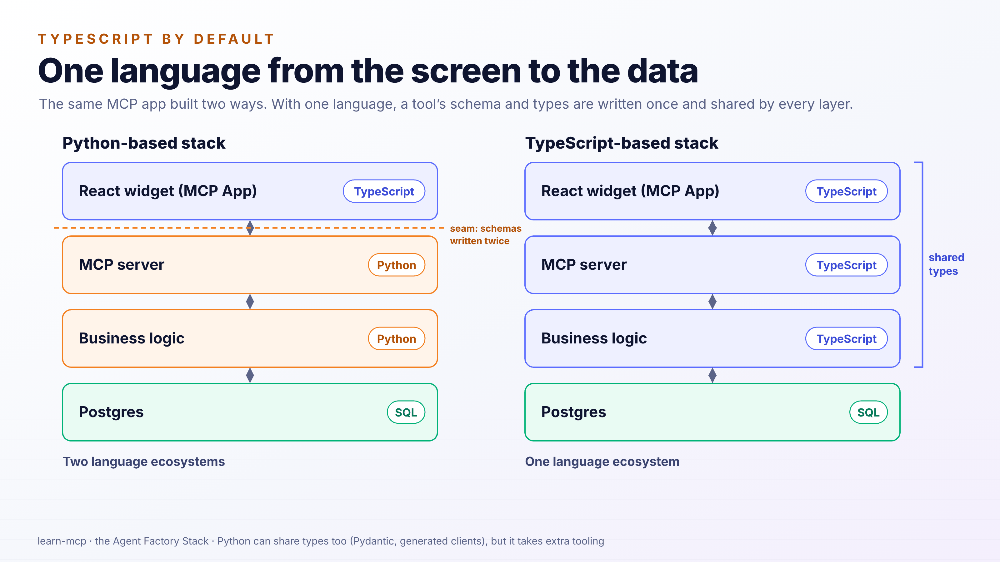
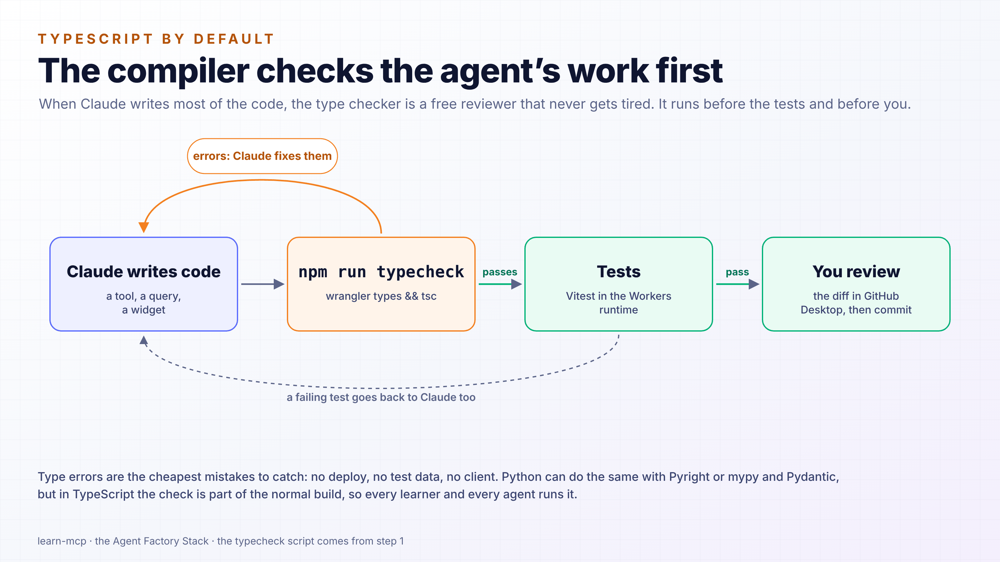

# TypeScript and Workers by Default: Why the Agent Factory Stack Picks Them, and When It Doesn't

The [Agent Factory Stack](agent-factory-stack.md) makes two choices that surprise people who learned AI through Python: it builds MCP apps in **TypeScript** rather than Python, and runs them on **Cloudflare Workers** rather than in containers. This page explains why, and when you should choose the other way.

**Neither choice says the other is worse.** Python is still the best language for machine learning, and containers are still the right home for heavy or unusual workloads. The choices follow from what kind of work an MCP app is.

## The job has changed

In a connector-native MCP app, Claude or ChatGPT does the understanding, reasoning and planning. Your app supplies signed-in access to a company's business capabilities: its data, its tools, its rules and its screens. That is mostly **integration engineering, not machine learning**.

| The previous generation of AI apps | Connector-native MCP apps |
| --- | --- |
| Model-centric | Business-centric |
| Python-first | TypeScript-first, where it fits |
| Training and fine-tuning | Integration and orchestration |
| ML frameworks | MCP and tool contracts |
| Container-first infrastructure | Serverless-first infrastructure |
| Custom chat interfaces | The AI clients people already use |
| Building intelligence | Connecting intelligence to business capabilities |

Traditional AI engineering isn't disappearing. A new kind of AI application engineering is growing beside it, and this bootcamp trains you for that one.

Look at what Stockroom's sales assistant needs, across the bootcamp's 21 steps: sign people in, read and write each company's records in Postgres, define tools and their schemas, enforce roles and business rules, show interactive screens, run background jobs and keep audit logs. None of that needs Python's machine learning libraries, because the model is already in Claude or ChatGPT. If your app ever does need its own model calls, the major model APIs have official TypeScript SDKs too.

## TypeScript by default

| What you need | TypeScript | Python |
| --- | --- | --- |
| Machine learning and model training | Limited | Excellent |
| Data science and numerical computing | Good | Excellent |
| MCP servers | Excellent (official SDK) | Excellent (official SDK) |
| Interactive MCP Apps screens | Native: React widgets | Needs JavaScript or TypeScript for the screen anyway |
| One language from screen to server | Yes | Usually two languages |
| Type checking at build time | Built in | Optional tools (Pyright, mypy) |
| Running on Cloudflare Workers | First-class | Supported through Pyodide, with package limits |
| Better Auth | Native (it is a TypeScript library) | Needs a separate service or another auth library |

### One language from the screen to the data

<picture>
  <source media="(prefers-color-scheme: dark)" srcset="../assets/diagram-one-language-dark.png">
  <source media="(prefers-color-scheme: light)" srcset="../assets/diagram-one-language-light.png">
  
</picture>

An MCP App's screens are web pages, so they are written in JavaScript or TypeScript whatever the server uses. With a Python server you work in two language ecosystems and define each tool's data shapes twice. With TypeScript, a tool's Zod schema (step 2) validates the input, types the business logic and types the widget that shows the result (step 9). Python can share types too, with Pydantic and generated clients, but it takes extra tooling.

### The compiler checks the agent's work first

<picture>
  <source media="(prefers-color-scheme: dark)" srcset="../assets/diagram-typecheck-loop-dark.png">
  <source media="(prefers-color-scheme: light)" srcset="../assets/diagram-typecheck-loop-light.png">
  
</picture>

In this bootcamp Claude writes most of the code and you direct and review it. Every check that runs before you look makes that safer, and the type checker is the cheapest one: it needs no deploy, no test data and no client. Each step's `typecheck` script (`wrangler types && tsc`, set up in step 1) catches a wrong field name, a missing binding or a tool result in the wrong shape, and Claude fixes it before the tests run. Python can do the same with Pyright or mypy and Pydantic, but in TypeScript the check is part of the normal build, so every learner and every agent runs it.

### And Python?

Cloudflare now supports [Python Workers](https://developers.cloudflare.com/workers/languages/python/). They run on [Pyodide](https://developers.cloudflare.com/workers/languages/python/how-python-workers-work/), CPython compiled to WebAssembly inside a V8 isolate, and support pure-Python packages plus those built for Pyodide, so not every PyPI package works. The book writes its lab connector in both TypeScript and Python ([17.6 How do you trust a connector an agent wrote?](https://agentfactory.panaversity.org/building-ai-workers/connectors-and-mcp/specify-generate-verify/)) to show that MCP doesn't depend on the language. This bootcamp picks one, so you go deep in it.

**Our default:** TypeScript for AI application engineering. Python for machine learning, scientific computing and heavy data processing.

## Workers by default

A typical MCP tool call goes like this: the AI client asks for a tool, your server checks the sign-in and validates the input, queries Neon or another API, applies the business rules and returns a structured result. It needs no process running between calls (MCP is stateless since the 2026-07-28 spec), and it spends most of its time **waiting** on the database, not computing. That is exactly the work Workers are built for.

### Isolates, not containers

A container packages an app with its own runtime and dependencies, and starts like a small machine. A Worker runs in a **V8 isolate**, a lightweight sandbox inside a runtime that many Workers share. Cloudflare says an isolate [starts around a hundred times faster](https://developers.cloudflare.com/workers/reference/how-workers-works/) than a Node process in a container or virtual machine. That is a startup comparison: your code doesn't run a hundred times faster, but there is almost no cold start to wait for.

| | Cloudflare Workers | Containers |
| --- | --- | --- |
| Startup | Very fast | Slower, depending on the image |
| Infrastructure to manage | Almost none | Depends on the platform |
| Dockerfile and image | Not needed | Usually needed |
| Scaling | Automatic | Depends on the platform |
| Runs close to users worldwide | Built in | Needs configuration or a managed platform |
| Cost when idle | Nothing | Depends on the hosting model |
| Memory | [128 MB per isolate](https://developers.cloudflare.com/workers/platform/limits/) | Configurable |
| Operating system and native libraries | Restricted | Full |
| Heavy computation | Limited by CPU time per request | Excellent |
| Fit for a stateless MCP server | Excellent | Good |
| Portability to another host | Moderate | Excellent |

Managed container platforms can also scale automatically and scale to zero, so the comparison isn't "managed versus unmanaged". Workers simply take the abstraction further.

### Why it's cheap to start

On Workers you pay for requests and [CPU time](https://developers.cloudflare.com/workers/platform/pricing/), and time spent [waiting on network requests, KV reads or database queries doesn't count as CPU time](https://developers.cloudflare.com/workers/platform/limits/). An MCP server that mostly waits on Neon uses very little CPU per call. Picture a student's inventory app that gets a few dozen calls a day: on Workers it costs nothing on the free plan, while an always-on container is paid for around the clock. A scale-to-zero container narrows that gap, and actual costs depend on your traffic, CPU use, database and the platform you compare with. The [Costs and cleanup](costs-and-cleanup.md) guide lists the free-plan limits.

### From infrastructure engineering to business engineering

A container setup asks you to understand Dockerfiles and images, registries, runtimes, load balancing, scaling policies, monitoring and operating system dependencies. Managed platforms hide some of that. On Workers you write the app, declare its bindings in the Wrangler config and run `wrangler deploy`. When agents write more of the code, your attention is what's scarce, and it belongs on the client's business: tool contracts, data design, tenant isolation, governance and evals.

### And Google Cloud Run?

Cloud Run is the strongest container alternative for MCP apps: fully managed, scaling to zero and deployable from source. It wins on portability and runtime flexibility, and Workers win on the cost of waiting, global deployment and starting free with no credit card. Read **[Cloudflare Workers or Google Cloud Run?](workers-vs-cloud-run.md)** for the full comparison.

## When Python and containers are the better choice

| What you're building | Better choice |
| --- | --- |
| A CRM, accounting, HR or e-commerce MCP app | TypeScript on Workers |
| Interactive dashboards and SaaS integrations | TypeScript on Workers |
| Training or fine-tuning a model | Python in containers, often with GPUs |
| Advanced statistics and scientific computing | Python |
| Heavy PDF, image or video processing | A container |
| Running code someone else wrote | An isolated container or sandbox |
| Running an open model yourself | Containers on GPU infrastructure |
| A library with native system dependencies | A container |

Workers have [limits](https://developers.cloudflare.com/workers/platform/limits/): 128 MB of memory per isolate and a cap on CPU time per request that depends on your plan. A job that needs more memory, many CPU cores or native system libraries belongs in a container.

## Workers first, a container when needed

<picture>
  <source media="(prefers-color-scheme: dark)" srcset="../assets/diagram-workers-first-dark.png">
  <source media="(prefers-color-scheme: light)" srcset="../assets/diagram-workers-first-light.png">
  
</picture>

You don't have to choose one platform for everything. [Cloudflare Containers](https://developers.cloudflare.com/containers/) run code in any language or runtime as part of an app built on Workers: container instances start on demand and are controlled by code in your Worker. So a Workers-first app can send a rare heavy job to a container without adding a second host. Containers need the Workers Paid plan. This bootcamp never needs one, because every step fits in a Worker, but it is the path to take when a client project outgrows one.

## Six engineering principles

These sum up the defaults this bootcamp teaches:

1. **TypeScript by default.** Python when specialized libraries justify it.
2. **Workers by default.** Containers when the resources a job needs justify them.
3. **Stateless by default.** Durable state, in Durable Objects or Workflows, only when a feature needs it (steps 11 and 13).
4. **Postgres as the system of record**, with pgvector for search by meaning (steps 5 to 8).
5. **MCP-first integration.** Expose business capabilities to the AI clients people already use.
6. **Security, governance and evals by design**, from the first tool (steps 4, 7, 16 and 17).

## The trade-off

The cost of these defaults is lock-in to Cloudflare's runtime and the limits of Workers. Keep business logic in plain TypeScript modules that don't call Cloudflare APIs directly, and keep the data in standard Postgres, and a move stays possible. The stack guide's [lock-in section](agent-factory-stack.md#the-honest-trade-off-lock-in) lists what moves and what doesn't.

This is an architectural recommendation, not the result of production benchmarks, and not a claim that the industry has standardized on it. The goal it serves is simple: **not to teach every AI engineer to build intelligence, but to turn intelligence into reliable, secure and valuable business capabilities.**

---

Back to [The Agent Factory Stack](agent-factory-stack.md) · [Costs and cleanup](costs-and-cleanup.md) · [Main README](../README.md#why-this-stack)
